{ width=35% }

**Universidad:** Jala University  
**Curso:** Desarrollo de Software IV  
**Docente:** Juan Esteves  
**Estudiante:** Diego Alejandro Botina  
**Fecha de entrega:** 20 de octubre de 2026

\newpage

## 1. Enlace al repositorio

El código fuente del proyecto se encuentra alojado en GitLab, dentro del subgrupo asignado al estudiante:

**https://gitlab.com/jala-university1/cohort-5/ES.CSSD-245.GA.T2.26.M2/SD/group-b/individual-laboratories/alejandro-botina/week-03/jala-u-ds4-web-components**

El mismo repositorio se encuentra replicado en GitHub, dentro de la organización JalaU-Labs:

**https://github.com/JalaU-Labs/jala-u-ds4-web-components**

Ambos repositorios reciben los mismos commits de forma simultánea. La rama principal es `main` en los dos. El repositorio de GitLab es el principal y el que aloja el pipeline de integración continua que valida cada push.

\newpage

## 2. Estructura del proyecto

La siguiente captura muestra la vista raíz del repositorio en GitLab, con la estructura de directorios y los archivos de configuración.

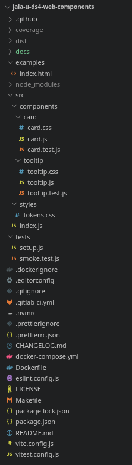

\newpage

## 3. Componente Card

### 3.1 Las tres variantes en una misma página

La siguiente captura muestra el componente `Card` renderizado en sus tres variantes (`default`, `outlined`, `elevated`). La tercera tarjeta incluye dos botones de acción.

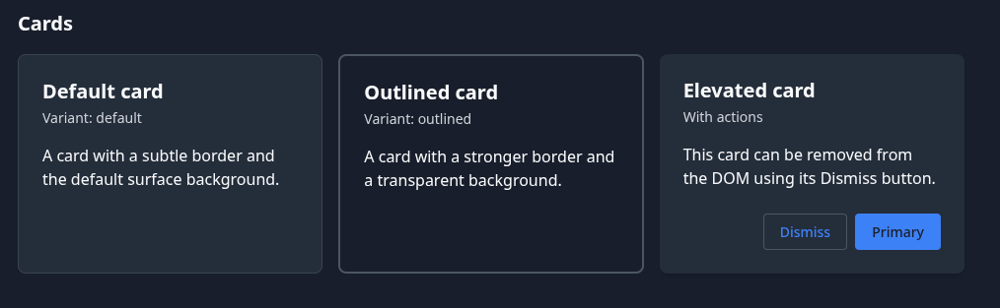

### 3.2 Interacción con acciones

Al pulsar el botón "Dismiss" de la tarjeta elevada, el componente se elimina del DOM como resultado de la llamada interna a `destroy()`. La siguiente captura muestra el estado del demo después de la interacción.

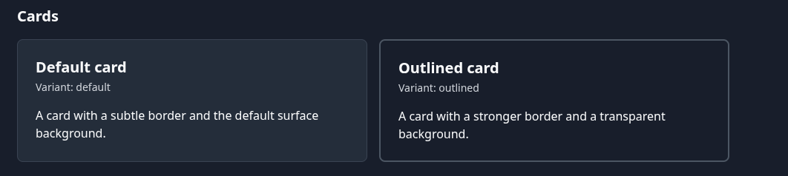

\newpage

## 4. Componente Tooltip

### 4.1 Tooltip visible en la posición superior

Al pasar el cursor sobre el botón "Hover top", el tooltip aparece anclado en la parte superior del elemento.

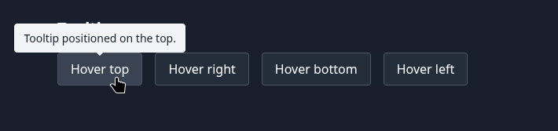

### 4.2 Tooltip visible en la posición derecha

De forma análoga, al pasar el cursor sobre el botón "Hover right", el tooltip aparece anclado a la derecha.

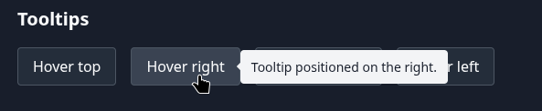

### 4.3 Tooltip visible al enfocar con teclado

El tooltip también aparece cuando el botón objetivo recibe el foco mediante el teclado (por ejemplo, navegando con la tecla Tab). La siguiente captura muestra el tooltip visible con el botón enfocado.

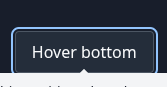

\newpage

## 5. Pruebas automatizadas

La siguiente captura muestra la salida del comando `make ci` ejecutado localmente. Se observa la secuencia completa: análisis estático con ESLint, verificación de formato con Prettier, ejecución de las 49 pruebas unitarias con Vitest, y generación de los artefactos de distribución con Vite.

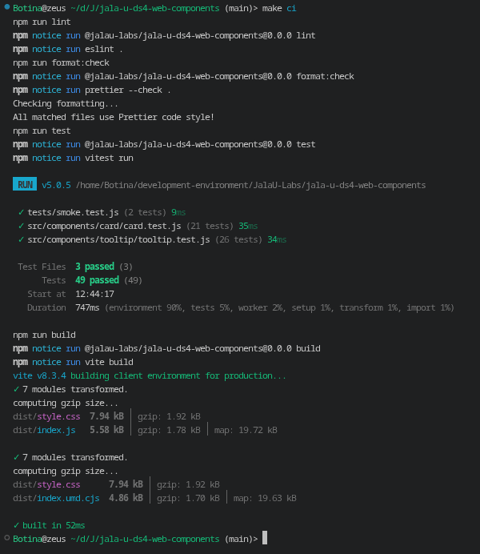

La siguiente captura muestra el reporte de cobertura generado por Vitest. La cobertura combinada de la carpeta `src/components/` es del 98%.

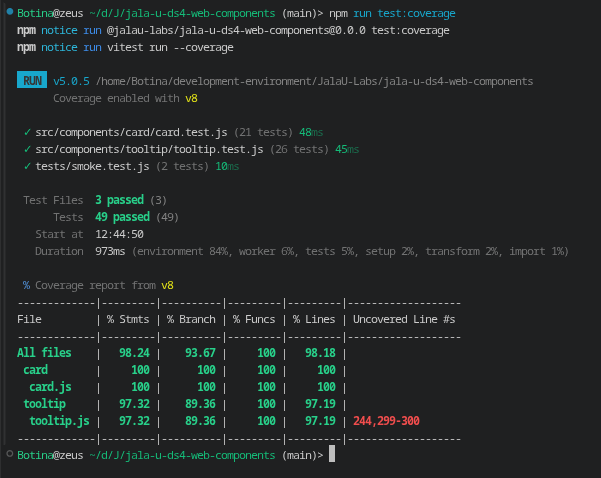

\newpage

## 6. Integración continua

### 6.1 Pipeline en GitLab

La siguiente captura muestra el pipeline de GitLab CI en estado exitoso, con los tres jobs (`lint`, `test`, `build`) ejecutados correctamente.

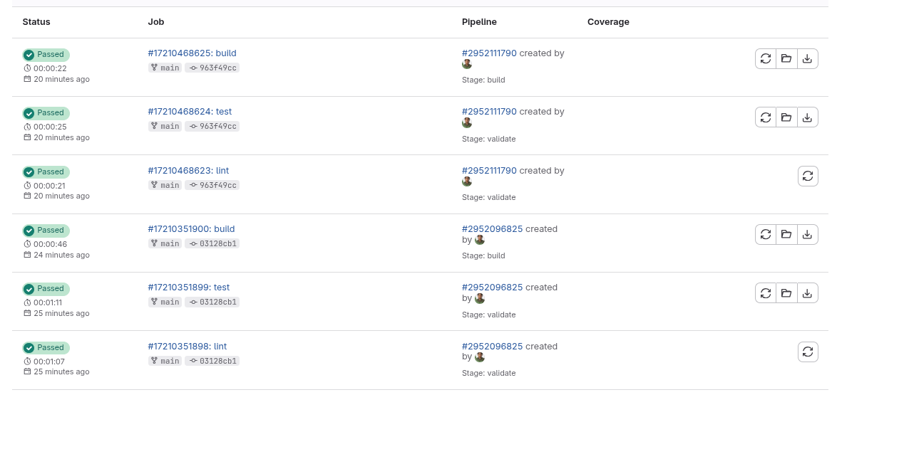

### 6.2 Workflow en GitHub Actions

La siguiente captura muestra el workflow de GitHub Actions ejecutado sobre el mismo commit, también en estado exitoso.

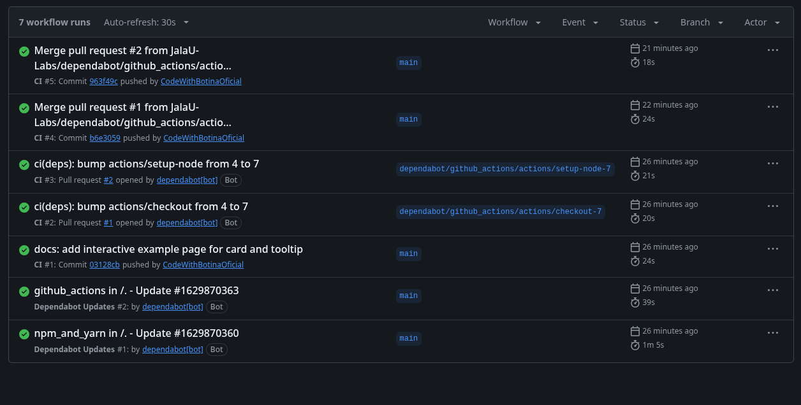

\newpage

## 7. Artefactos de distribución

La siguiente captura muestra el contenido del directorio `dist/` después de ejecutar `make build`. Se observan los dos bundles (ESM y UMD), el CSS agregado y los mapas de código fuente.

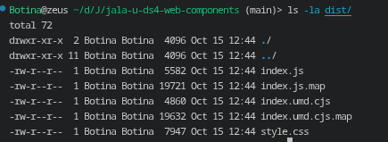
